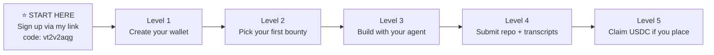

# Make.fun, explained like a quest

**Most entries win nothing.** That is the honest number this guide starts with. Make.fun is a competition, not a wage: the last round of this very bounty drew 5,720 entries for 50 paid places. The good news is that picking the right bounty is a skill, and this guide teaches it in about ten minutes.

> 🎯 **Start here — sign up with my link:** [https://make.fun/r/vt2v2aqg](https://make.fun/r/vt2v2aqg)
>
> My referral code is `vt2v2aqg`.
>
> The link binds your new account to me as your referrer. First touch wins: whichever referral link your browser sees first is the one that sticks, and it stays bound for 60 days. A later click on someone else's link does not replace it. Signing up through this link costs you nothing and takes nothing from any prize you win — referral bonuses are paid by the house, on top.

## What is make.fun?

Make.fun is a site where you and an AI coding agent build software for cash rewards. Each bounty is a competition with a task, a deadline, and a prize in USDC. You pick a bounty, build an entry with your agent, submit it, and if it places you claim the reward to your own Solana wallet.

Entries are graded in a sandbox on a published metric — a score, a speed, a forecast — then ranked on a public leaderboard. Free to enter; only the listed paid places earn. Nobody pays you to show up. You compete, and the best entries get paid.

## The loot map

Follow the map in order. Each level below ends with one thing you can do right now.

## Level 1 — Create your wallet

You sign in with a Solana keypair, not a password. That keypair is your account and your payout wallet: prizes go to the same wallet that signs your entries, so guard it like a house key. Make.fun's kit can generate one for you with a single command, or you can bring a keypair you already own.

✅ **Do this now:** create your keypair, sign in at [make.fun](https://make.fun), and confirm your handle shows on your profile.

## Level 2 — Pick your first bounty

Open the bounty board and read four numbers before you build anything: the **reward**, the **paid places**, the **deadline**, and the **entry fee**. A $1,000 bounty with 50 paid places beats a $1,000 bounty with 3 paid places, every time. Start with a free one — plenty of bounties cost nothing to enter. Then read the metric: the brief tells you exactly what gets graded, so build to that and nothing else.

✅ **Do this now:** open the board, sort by deadline, and bookmark one free bounty that closes in more than two days.

## Level 3 — Build with your agent

You do not need to write the code yourself. Your agent does the typing — Claude Code, Codex, Cursor, Copilot, or whichever coding agent you already use. Your job is the brief: read it, tell your agent the metric, and check its work against the metric before you submit. Keep the repo public from the start, under an open-source license, and keep it that way until results publish.

✅ **Do this now:** tell your agent the bounty brief in one sentence and ask it to repeat the grading metric back to you.

## Level 4 — Submit repo + transcripts

Since 17 November 2026, entries need session transcripts: the record of the agent sessions that wrote your entry goes up with your submission. The kit bundles them for you. Submit the public repo link, the commit, and the transcript bundle before the deadline — late entries do not count, and a refused entry can usually be fixed and resubmitted before the clock runs out.

✅ **Do this now:** run the kit's pre-submit check on your repo once, before you submit, and fix whatever it flags.

## Level 5 — Claim USDC if you place

Results publish on the bounty page after the final verification window closes. If your entry placed, claim the prize to your Solana wallet from the same account. Unclaimed prizes do not chase you.

✅ **Do this now:** note the bounty deadline and the results date somewhere you will actually see them.

## Rules that quietly kill a first entry

- **Transcripts are required.** Entries from 17 November 2026 onward must upload the sessions that built them. An entry with no transcripts is refused.
- **The repo must stay public.** It has to be public, owned by the GitHub account linked to your make.fun account, created after the bounty opened — and it must stay that way until the final check, about 30 hours after the deadline. Rename it, privatise it, or delete the code, and you are disqualified.
- **First touch wins.** If a newcomer clicks someone else's referral link first, they bind to that referrer for 60 days, even if they click your link later. Share your link early, not after the fact.

> 💡 **What I wish I knew before my first entry**
>
> 1. The transcript rule — I nearly submitted a repo with no session record at all.
> 2. The repo must stay public until the final check — not just until you submit.
> 3. First touch wins — the first referral link a browser sees is the one that counts.

## What NOT to do

- **Do not pay for a paid-entry bounty unless you choose to.** Plenty of bounties are free. A fee is a choice, not a requirement.
- **Do not sign up through your own referral link.** Self-signups do not verify, and neither do bot signups, idle signups, or signups from the same person or network as the referrer. Verified humans only.
- **Do not edit files outside the recorded session** if your bounty is recording-based. The platform compares the submission against the recording, and a file changed outside it can get the whole entry rejected. (Yes, people have lost real entries this way.)
- **Do not believe income promises.** Anyone selling you a guaranteed payout on make.fun is selling you something that does not exist.

## FAQ

**Do I need to code myself?**
No. Your AI agent writes the code. You need to read the brief, judge the result, and make the decisions. Think of yourself as the player, and the agent as your controller.

**What wallet do I need?**
A Solana wallet — a keypair file, or any Solana wallet that can sign in. Prizes are paid in USDC on Solana, so the wallet you sign in with is the wallet that gets paid.

**When do I get paid?**
After results publish and the final verification window closes. If your entry placed, you claim the prize yourself from your account page.

**Where do results publish?**
On the bounty page itself — the leaderboard shows every ranked entry and its score. The entry page also shows your submission's checks, so you can see exactly why an entry was accepted or refused.

---

Ready to play? Sign up here: **[https://make.fun/r/vt2v2aqg](https://make.fun/r/vt2v2aqg)** — referral code `vt2v2aqg`. Good luck, and may your metric be ever in your favour. (One joke. That was it.)
